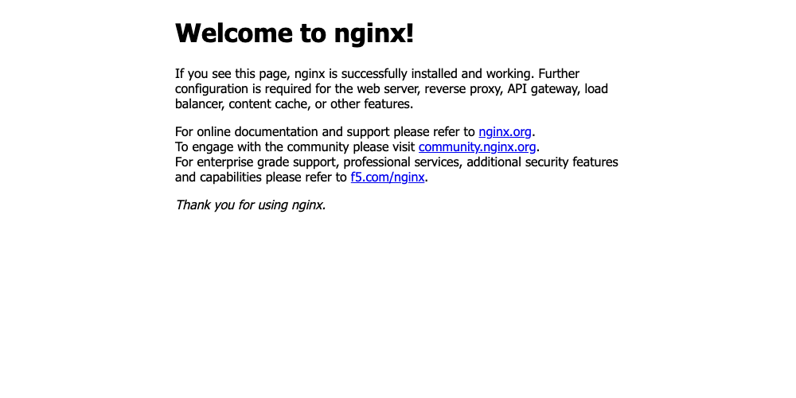

# Assignment 2 – Part 1: Docker Networking

**Author:** hammuneer
**GitHub repository:** https://github.com/hammuneer/dice-assignment2-part1-docker-networking

This repository documents how to create a user-defined Docker **bridge network**, attach `nginx` and `httpd`
containers to it, publish their ports to the host, inspect the network, replace a container, and clean everything up.
Each step gives a short description of the command, the exact command, the real output, and what the output shows.

| Item | Description |
|------|-------------|
| [`network-demo.sh`](network-demo.sh) | Script that re-runs every step in order and writes the output to `logs/` |
| [`logs/`](logs) | Raw output of every command (one file per step) |
| [`screenshots/`](screenshots) | Browser screenshots of the pages at `localhost:8080`, `8081` and `8082` |

**Environment:** macOS (Apple Silicon), Docker Engine 29.2.1, images `nginx:latest` (nginx 1.31.8) and `httpd:latest` (Apache 2.4.69).

### Summary

| # | Task | Marks | Result |
|---|------|-------|--------|
| 1 | Create `my_network` with the bridge driver | 2 | Created, subnet `172.21.0.0/16` |
| 2 | Run `nginx_container` on `my_network` | 4 | Running, IP `172.21.0.2` |
| 3 | Verify nginx at http://localhost:8080 | 2 | HTTP 200, "Welcome to nginx!" |
| 4 | Run `httpd_container` on `my_network` | 4 | Running, IP `172.21.0.3` |
| 5 | Verify httpd at http://localhost:8081 | 2 | HTTP 200, "It works!" |
| 6 | `docker network inspect my_network` | 4 | Both containers listed; name-based DNS also tested |
| 7 | Stop and remove `nginx_container` | 2 | Removed, detached from the network automatically |
| 8 | Run `nginx_container_2` on `my_network` | 4 | Running, reused IP `172.21.0.2` |
| 9 | Verify nginx at http://localhost:8082 | 2 | HTTP 200, "Welcome to nginx!" |
| 10 | `docker container ls` | 4 | Both containers shown with ports and network |
| 11 | Stop and remove all containers | 2 | Removed |
| 12 | Remove `my_network` | 2 | Removed |
| 13 | README.md | 18 | This document |

---

## Table of Contents

0. [Background: Docker networking](#0-background-docker-networking)
1. [Create the network](#step-1--create-the-network)
2. [Run nginx_container](#step-2--run-nginx_container-on-my_network)
3. [Verify localhost:8080](#step-3--verify-the-nginx-page-on-localhost8080)
4. [Run httpd_container](#step-4--run-httpd_container-on-my_network)
5. [Verify localhost:8081](#step-5--verify-the-httpd-page-on-localhost8081)
6. [Inspect the network](#step-6--inspect-my_network)
7. [Remove nginx_container](#step-7--stop-and-remove-nginx_container)
8. [Run nginx_container_2](#step-8--run-nginx_container_2-on-my_network)
9. [Verify localhost:8082](#step-9--verify-the-nginx-page-on-localhost8082)
10. [List running containers](#step-10--list-running-containers)
11. [Remove all containers](#step-11--stop-and-remove-all-containers)
12. [Remove the network](#step-12--remove-my_network)
13. [Findings and conclusions](#findings-and-conclusions)
14. [How to reproduce](#how-to-reproduce)

---

## 0. Background: Docker networking

Every container gets its own network stack (its own interfaces, IP address and ports). Docker networks decide
which containers can communicate with each other:

| Driver | Behaviour |
|--------|-----------|
| `bridge` | A private virtual switch on the host. Containers on the same bridge can reach each other; the outside world reaches them only through **published ports**. |
| `host` | The container shares the host's network stack directly (no isolation, no port mapping). |
| `none` | No networking at all. |

A **user-defined bridge** (like `my_network`) is preferred over the default `bridge` network because it provides
**automatic DNS resolution by container name**, better isolation (only containers explicitly attached can talk to each other),
and containers can be attached or detached while running.

**Port publishing** (`-p HOST:CONTAINER`) forwards a port on the host to a port inside the container. In this assignment
nginx and httpd both listen on port 80 *inside* their containers. Each container has its own network namespace, so both
can use port 80; only the host ports (8080, 8081, 8082) must be different.

```
                    Host (macOS)  localhost:8080  localhost:8081  localhost:8082
                                        │               │               │
  ┌──────────────── my_network (bridge 172.21.0.0/16, gateway 172.21.0.1) ─────────┐
  │   nginx_container (.2):80     httpd_container (.3):80   nginx_container_2 (.2):80│
  └────────────────────────────────────────────────────────────────────────────────┘
```

---

## Step 1 – Create the network

`docker network create` creates a new network. `--driver bridge` selects the bridge driver (this is also the
default, but the assignment asks for it explicitly). `docker network ls` lists networks, here filtered by name.

```bash
docker network create --driver bridge my_network
docker network ls --filter name=my_network
```

**Output** ([logs/01-create-network.log](logs/01-create-network.log)):

```
$ docker network create --driver bridge my_network
b53588b73690995ab4be89b019e3d046f960dcf09eec1347106b921b5f3f88f9

$ docker network ls --filter name=my_network
NETWORK ID     NAME         DRIVER    SCOPE
b53588b73690   my_network   bridge    local
```

**Finding:** Docker returns the full 64-character network ID. The network uses the `bridge` driver with `local`
scope, meaning it exists only on this Docker host.

---

## Step 2 – Run nginx_container on my_network

`docker run` creates and starts a container from an image.

| Flag | Meaning |
|------|---------|
| `-d` | Detached: run in the background and print the container ID |
| `--name nginx_container` | Fixed container name (also its DNS name on `my_network`) |
| `--network my_network` | Connect to `my_network` instead of the default bridge |
| `-p 8080:80` | Publish container port 80 on host port 8080 |

`docker ps --filter` shows the container's status, and `docker logs` shows what the container wrote to stdout/stderr.

```bash
docker run -d --name nginx_container --network my_network -p 8080:80 nginx
docker ps --filter name=nginx_container
docker logs nginx_container
```

**Output** ([logs/02-nginx-container.log](logs/02-nginx-container.log)):

```
$ docker run -d --name nginx_container --network my_network -p 8080:80 nginx
03e77b6c8dc7dea841d0b5cc94468d023cc9d8752a7f85c87b70cefeb58f3ace

$ docker ps --filter name=nginx_container
CONTAINER ID   IMAGE     COMMAND                  CREATED         STATUS         PORTS                                     NAMES
03e77b6c8dc7   nginx     "/docker-entrypoint.…"   3 seconds ago   Up 2 seconds   0.0.0.0:8080->80/tcp, [::]:8080->80/tcp   nginx_container

$ docker logs nginx_container
/docker-entrypoint.sh: /docker-entrypoint.d/ is not empty, will attempt to perform configuration
/docker-entrypoint.sh: Looking for shell scripts in /docker-entrypoint.d/
/docker-entrypoint.sh: Launching /docker-entrypoint.d/10-listen-on-ipv6-by-default.sh
10-listen-on-ipv6-by-default.sh: info: Getting the checksum of /etc/nginx/conf.d/default.conf
10-listen-on-ipv6-by-default.sh: info: Enabled listen on IPv6 in /etc/nginx/conf.d/default.conf
/docker-entrypoint.sh: Sourcing /docker-entrypoint.d/15-local-resolvers.envsh
/docker-entrypoint.sh: Launching /docker-entrypoint.d/20-envsubst-on-templates.sh
/docker-entrypoint.sh: Launching /docker-entrypoint.d/30-tune-worker-processes.sh
/docker-entrypoint.sh: Configuration complete; ready for start up
2026/11/17 09:13:56 [notice] 1#1: using the "epoll" event method
2026/11/17 09:13:56 [notice] 1#1: nginx/1.31.8
2026/11/17 09:13:56 [notice] 1#1: built by gcc 14.2.0 (Debian 14.2.0-19)
2026/11/17 09:13:56 [notice] 1#1: OS: Linux 6.12.72-linuxkit
2026/11/17 09:13:56 [notice] 1#1: getrlimit(RLIMIT_NOFILE): 1048576:1048576
2026/11/17 09:13:56 [notice] 1#1: start worker processes
2026/11/17 09:13:56 [notice] 1#1: start worker process 29
...  (16 worker processes in total, one per CPU core)
2026/11/17 09:13:56 [notice] 1#1: start worker process 44
```

**Finding:** The container is `Up`, and `0.0.0.0:8080->80/tcp` confirms the port mapping on all host interfaces
(IPv4 and IPv6). The logs show the nginx entrypoint configuring itself, then the master process (PID 1) starting one
worker process per CPU core.

---

## Step 3 – Verify the nginx page on localhost:8080

`curl` makes an HTTP request from the host. `-w '%{http_code}'` prints only the HTTP status code; the second command
prints the page title and heading.

```bash
curl -s -o /dev/null -w 'HTTP status: %{http_code}\n' http://localhost:8080
curl -s http://localhost:8080 | grep -i '<title>\|<h1>'
```

**Output** ([logs/03-verify-8080.log](logs/03-verify-8080.log)):

```
HTTP status: 200
<title>Welcome to nginx!</title>
<h1>Welcome to nginx!</h1>
```

**Browser** – http://localhost:8080:


**Finding:** The nginx default page is reachable from the host through the published port 8080.

---

## Step 4 – Run httpd_container on my_network

The same as Step 2, using the official Apache `httpd` image, published on host port 8081.

```bash
docker run -d --name httpd_container --network my_network -p 8081:80 httpd
docker ps --filter name=httpd_container
docker logs httpd_container
```

**Output** ([logs/04-httpd-container.log](logs/04-httpd-container.log)):

```
$ docker run -d --name httpd_container --network my_network -p 8081:80 httpd
9f552fb33e3990912ff06040ad312e7a826ff6cc357347f85fa6240427049d08

$ docker ps --filter name=httpd_container
CONTAINER ID   IMAGE     COMMAND              CREATED         STATUS         PORTS                                     NAMES
9f552fb33e39   httpd     "httpd-foreground"   2 seconds ago   Up 2 seconds   0.0.0.0:8081->80/tcp, [::]:8081->80/tcp   httpd_container

$ docker logs httpd_container
AH00558: httpd: Could not reliably determine the server's fully qualified domain name, using 172.21.0.3. Set the 'ServerName' directive globally to suppress this message
AH00558: httpd: Could not reliably determine the server's fully qualified domain name, using 172.21.0.3. Set the 'ServerName' directive globally to suppress this message
[Tue Nov 17 09:14:06.945338 2026] [mpm_event:notice] [pid 1:tid 1] AH00489: Apache/2.4.69 (Unix) configured -- resuming normal operations
[Tue Nov 17 09:14:06.946615 2026] [core:notice] [pid 1:tid 1] AH00094: Command line: 'httpd -D FOREGROUND'
```

**Finding:** Apache 2.4.69 started successfully. The `AH00558` message is a harmless warning: no `ServerName` is
configured, so Apache uses the container's IP address `172.21.0.3`. That address comes from `my_network`'s subnet,
which confirms the container is attached to our network.

---

## Step 5 – Verify the httpd page on localhost:8081

```bash
curl -s -o /dev/null -w 'HTTP status: %{http_code}\n' http://localhost:8081
curl -s http://localhost:8081
```

**Output** ([logs/05-verify-8081.log](logs/05-verify-8081.log)):

```
HTTP status: 200
<!DOCTYPE HTML PUBLIC "-//W3C//DTD HTML 4.01//EN" "http://www.w3.org/TR/html4/strict.dtd">
<html>
<head>
<title>It works! Apache httpd</title>
</head>
<body>
<p>It works!</p>
</body>
</html>
```

**Browser** – http://localhost:8081:


**Finding:** The Apache default "It works!" page is reachable from the host on port 8081.

---

## Step 6 – Inspect my_network

`docker network inspect` prints the full configuration of a network as JSON: its driver, IP address management (IPAM)
settings and every attached container. `--format` uses a Go template to extract only specific fields.

```bash
docker network inspect my_network
docker network inspect my_network --format '{{range .IPAM.Config}}Subnet={{.Subnet}} Gateway={{.Gateway}}{{end}}'
docker network inspect my_network --format '{{range .Containers}}{{.Name}} -> {{.IPv4Address}}{{println}}{{end}}'
```

**Output** ([logs/06-network-inspect.log](logs/06-network-inspect.log)):

```json
[
    {
        "Name": "my_network",
        "Id": "b53588b73690995ab4be89b019e3d046f960dcf09eec1347106b921b5f3f88f9",
        "Created": "2026-11-17T09:13:47.959179134Z",
        "Scope": "local",
        "Driver": "bridge",
        "EnableIPv4": true,
        "EnableIPv6": false,
        "IPAM": {
            "Driver": "default",
            "Options": {},
            "Config": [
                {
                    "Subnet": "172.21.0.0/16",
                    "Gateway": "172.21.0.1"
                }
            ]
        },
        "Internal": false,
        "Attachable": false,
        "Ingress": false,
        "ConfigFrom": {
            "Network": ""
        },
        "ConfigOnly": false,
        "Options": {
            "com.docker.network.enable_ipv4": "true",
            "com.docker.network.enable_ipv6": "false"
        },
        "Labels": {},
        "Containers": {
            "03e77b6c8dc7dea841d0b5cc94468d023cc9d8752a7f85c87b70cefeb58f3ace": {
                "Name": "nginx_container",
                "EndpointID": "e3ac005f185408d0c92d4256d61ecedfba266b15dc20cc9dc34f378e2081880b",
                "MacAddress": "8e:a1:04:44:b0:61",
                "IPv4Address": "172.21.0.2/16",
                "IPv6Address": ""
            },
            "9f552fb33e3990912ff06040ad312e7a826ff6cc357347f85fa6240427049d08": {
                "Name": "httpd_container",
                "EndpointID": "eb328164c7b56d119848d6aedf8c5cf0500ffd179d87cf03664c7d6cf1de2266",
                "MacAddress": "e6:7c:3d:e0:00:7b",
                "IPv4Address": "172.21.0.3/16",
                "IPv6Address": ""
            }
        },
        "Status": {
            "IPAM": {
                "Subnets": {
                    "172.21.0.0/16": {
                        "IPsInUse": 5,
                        "DynamicIPsAvailable": 65531
                    }
                }
            }
        }
    }
]
```

```
$ docker network inspect my_network --format '{{range .IPAM.Config}}Subnet={{.Subnet}} Gateway={{.Gateway}}{{end}}'
Subnet=172.21.0.0/16 Gateway=172.21.0.1

$ docker network inspect my_network --format '{{range .Containers}}{{.Name}} -> {{.IPv4Address}}{{println}}{{end}}'
nginx_container -> 172.21.0.2/16
httpd_container -> 172.21.0.3/16
```

### Findings from `docker network inspect`

| Field | Value | What it means |
|-------|-------|---------------|
| `Driver` | `bridge` | The network was created with the bridge driver as requested |
| `Scope` | `local` | The network exists only on this Docker host (not across a Swarm cluster) |
| `IPAM.Config.Subnet` | `172.21.0.0/16` | Docker automatically picked a free private subnet (65,536 addresses) |
| `IPAM.Config.Gateway` | `172.21.0.1` | The bridge's own address; containers route traffic out through it |
| `Containers` | 2 entries | `nginx_container` = `172.21.0.2`, `httpd_container` = `172.21.0.3`, assigned in the order they joined |
| `MacAddress` | unique per container | Each container has its own virtual Ethernet interface (veth) on the bridge |
| `Internal` | `false` | Containers on this network can reach external networks (internet) |
| `EnableIPv6` | `false` | Only IPv4 addressing is used inside the network |
| `Status.IPAM.IPsInUse` | `5` | Network address + gateway + broadcast + 2 containers |

### Extra test: container-to-container communication by name

Containers on a user-defined bridge can reach each other **by container name**, because Docker runs an embedded DNS
server (`127.0.0.11`) for them. `docker exec` runs a command inside a running container. Here we use it to call the
httpd container from inside the nginx container.

```bash
docker exec nginx_container curl -s http://httpd_container
docker exec nginx_container getent hosts httpd_container
```

**Output** ([logs/06-dns-test.log](logs/06-dns-test.log)):

```
$ docker exec nginx_container curl -s http://httpd_container
<!DOCTYPE HTML PUBLIC "-//W3C//DTD HTML 4.01//EN" "http://www.w3.org/TR/html4/strict.dtd">
<html>
<head>
<title>It works! Apache httpd</title>
</head>
<body>
<p>It works!</p>
</body>
</html>

$ docker exec nginx_container getent hosts httpd_container
172.21.0.3      httpd_container
```

**Finding:** The name `httpd_container` resolves to `172.21.0.3`, and nginx can fetch Apache's page directly over
`my_network` on port 80, without going through the host's published port. Automatic name resolution is available on
user-defined networks only, not on the default `bridge` network.

---

## Step 7 – Stop and remove nginx_container

`docker stop` sends `SIGTERM` to the container's main process, so it can shut down cleanly (Docker sends `SIGKILL` if it
has not stopped after 10 seconds). `docker rm` deletes the stopped container and its writable layer. Afterwards we confirm
that the container no longer exists, that it was detached from the network, and that port 8080 is no longer served.

```bash
docker stop nginx_container
docker rm nginx_container
docker ps -a --filter name=nginx_container
docker network inspect my_network --format '{{range .Containers}}{{.Name}} -> {{.IPv4Address}}{{println}}{{end}}'
curl -s -o /dev/null -w 'HTTP status: %{http_code}\n' http://localhost:8080 || echo 'Connection refused - port 8080 no longer served'
```

**Output** ([logs/07-remove-nginx.log](logs/07-remove-nginx.log)):

```
$ docker stop nginx_container
nginx_container

$ docker rm nginx_container
nginx_container

$ docker ps -a --filter name=nginx_container
CONTAINER ID   IMAGE     COMMAND   CREATED   STATUS    PORTS     NAMES

$ docker network inspect my_network --format '{{range .Containers}}{{.Name}} -> {{.IPv4Address}}{{println}}{{end}}'
httpd_container -> 172.21.0.3/16

$ curl -s -o /dev/null -w 'HTTP status: %{http_code}\n' http://localhost:8080 || echo 'Connection refused - port 8080 no longer served'
HTTP status: 000
Connection refused - port 8080 no longer served
```

**Finding:** Removing a container automatically disconnects it from the network and releases its IP address and its
host port. `httpd_container` was not affected.

---

## Step 8 – Run nginx_container_2 on my_network

A new nginx container, this time published on host port 8082.

```bash
docker run -d --name nginx_container_2 --network my_network -p 8082:80 nginx
docker ps --filter name=nginx_container_2
docker logs nginx_container_2 2>&1 | tail -5
docker network inspect my_network --format '{{range .Containers}}{{.Name}} -> {{.IPv4Address}}{{println}}{{end}}'
```

**Output** ([logs/08-nginx-container-2.log](logs/08-nginx-container-2.log)):

```
$ docker run -d --name nginx_container_2 --network my_network -p 8082:80 nginx
6cf3e0600c03e0ebfc0b90c66d4e6c390a85738c1c06b71a014e4be26f7cb38c

$ docker ps --filter name=nginx_container_2
CONTAINER ID   IMAGE     COMMAND                  CREATED         STATUS         PORTS                                     NAMES
6cf3e0600c03   nginx     "/docker-entrypoint.…"   2 seconds ago   Up 2 seconds   0.0.0.0:8082->80/tcp, [::]:8082->80/tcp   nginx_container_2

$ docker logs nginx_container_2 2>&1 | tail -5
2026/11/17 09:14:51 [notice] 1#1: start worker process 40
2026/11/17 09:14:51 [notice] 1#1: start worker process 41
2026/11/17 09:14:51 [notice] 1#1: start worker process 42
2026/11/17 09:14:51 [notice] 1#1: start worker process 43
2026/11/17 09:14:51 [notice] 1#1: start worker process 44

$ docker network inspect my_network --format '{{range .Containers}}{{.Name}} -> {{.IPv4Address}}{{println}}{{end}}'
nginx_container_2 -> 172.21.0.2/16
httpd_container -> 172.21.0.3/16
```

**Finding:** `nginx_container_2` received **`172.21.0.2`**, the address released by the removed `nginx_container`.
Container IP addresses are not permanent, so containers should talk to each other by **name** (DNS), never by
hard-coded IP.

---

## Step 9 – Verify the nginx page on localhost:8082

```bash
curl -s -o /dev/null -w 'HTTP status: %{http_code}\n' http://localhost:8082
curl -s http://localhost:8082 | grep -i '<title>\|<h1>'
```

**Output** ([logs/09-verify-8082.log](logs/09-verify-8082.log)):

```
HTTP status: 200
<title>Welcome to nginx!</title>
<h1>Welcome to nginx!</h1>
```

**Browser** – http://localhost:8082:



---

## Step 10 – List running containers

`docker container ls` (the same as `docker ps`) lists **running** containers. `--filter network=my_network` shows only
containers on our network, `--format` builds a custom table, and `--size` adds disk usage.

```bash
docker container ls
docker container ls --filter network=my_network
docker container ls --filter network=my_network --format 'table {{.Names}}\t{{.Image}}\t{{.Status}}\t{{.Ports}}\t{{.Networks}}'
docker container ls --filter network=my_network --size
```

**Output** ([logs/10-container-ls.log](logs/10-container-ls.log)):

```
$ docker container ls
CONTAINER ID   IMAGE                                 COMMAND                  CREATED          STATUS          PORTS                                                                                                                                  NAMES
6cf3e0600c03   nginx                                 "/docker-entrypoint.…"   10 seconds ago   Up 9 seconds    0.0.0.0:8082->80/tcp, [::]:8082->80/tcp                                                                                                nginx_container_2
9f552fb33e39   httpd                                 "httpd-foreground"       55 seconds ago   Up 54 seconds   0.0.0.0:8081->80/tcp, [::]:8081->80/tcp                                                                                                httpd_container
05416b4f6fef   gcr.io/k8s-minikube/kicbase:v0.0.51   "/usr/local/bin/entr…"   2 days ago       Up 2 days       127.0.0.1:57629->22/tcp, 127.0.0.1:57628->2376/tcp, 127.0.0.1:57626->5000/tcp, 127.0.0.1:57627->8443/tcp, 127.0.0.1:57625->32443/tcp   minikube

$ docker container ls --filter network=my_network
CONTAINER ID   IMAGE     COMMAND                  CREATED          STATUS          PORTS                                     NAMES
6cf3e0600c03   nginx     "/docker-entrypoint.…"   10 seconds ago   Up 9 seconds    0.0.0.0:8082->80/tcp, [::]:8082->80/tcp   nginx_container_2
9f552fb33e39   httpd     "httpd-foreground"       55 seconds ago   Up 54 seconds   0.0.0.0:8081->80/tcp, [::]:8081->80/tcp   httpd_container

$ docker container ls --filter network=my_network --format 'table {{.Names}}\t{{.Image}}\t{{.Status}}\t{{.Ports}}\t{{.Networks}}'
NAMES               IMAGE     STATUS          PORTS                                     NETWORKS
nginx_container_2   nginx     Up 9 seconds    0.0.0.0:8082->80/tcp, [::]:8082->80/tcp   my_network
httpd_container     httpd     Up 54 seconds   0.0.0.0:8081->80/tcp, [::]:8081->80/tcp   my_network

$ docker container ls --filter network=my_network --size
CONTAINER ID   IMAGE     COMMAND                  CREATED          STATUS          PORTS                                     NAMES               SIZE
6cf3e0600c03   nginx     "/docker-entrypoint.…"   10 seconds ago   Up 9 seconds    0.0.0.0:8082->80/tcp, [::]:8082->80/tcp   nginx_container_2   81.9kB (virtual 177MB)
9f552fb33e39   httpd     "httpd-foreground"       55 seconds ago   Up 54 seconds   0.0.0.0:8081->80/tcp, [::]:8081->80/tcp   httpd_container     36.9kB (virtual 130MB)
```

### Findings from `docker container ls`

| Column | Meaning |
|--------|---------|
| `CONTAINER ID` | Short (12-character) form of the container ID |
| `IMAGE` | Image the container was created from |
| `COMMAND` | Main process: nginx uses `/docker-entrypoint.sh`, httpd uses `httpd-foreground` |
| `STATUS` | `Up` plus uptime; `nginx_container` no longer appears because it was removed in Step 7 |
| `PORTS` | `0.0.0.0:8082->80/tcp`: host port 8082 forwards to container port 80 (IPv4 and IPv6) |
| `NETWORKS` | Both assignment containers are on `my_network` |
| `SIZE` | e.g. `81.9kB (virtual 177MB)`: only 81.9 kB is the container's own writable layer; the 177 MB of image layers are read-only and shared by all containers from that image |

> The `minikube` container in the first listing is unrelated to this assignment; it belongs to a local Kubernetes
> cluster on the same machine. The filtered commands show only the assignment containers.

---

## Step 11 – Stop and remove all containers

Both remaining assignment containers are stopped and removed. They are named explicitly rather than with
`docker rm -f $(docker ps -aq)`, because that command would also delete unrelated containers on the machine
(such as the `minikube` cluster).

```bash
docker stop nginx_container_2 httpd_container
docker rm nginx_container_2 httpd_container
docker container ls -a --filter name=nginx_container --filter name=httpd_container
```

**Output** ([logs/11-cleanup-containers.log](logs/11-cleanup-containers.log)):

```
$ docker stop nginx_container_2 httpd_container
nginx_container_2
httpd_container

$ docker rm nginx_container_2 httpd_container
nginx_container_2
httpd_container

$ docker container ls -a --filter name=nginx_container --filter name=httpd_container
CONTAINER ID   IMAGE     COMMAND   CREATED   STATUS    PORTS     NAMES
```

**Finding:** The empty listing (including stopped containers, `-a`) confirms that all assignment containers are gone.

---

## Step 12 – Remove my_network

`docker network rm` deletes a network. It fails if any container is still attached, so the containers were removed first.

```bash
docker network rm my_network
docker network ls
```

**Output** ([logs/12-remove-network.log](logs/12-remove-network.log)):

```
$ docker network rm my_network
my_network

$ docker network ls
NETWORK ID     NAME                     DRIVER    SCOPE
986d9975fe78   bridge                   bridge    local
2757ab452ea0   clef-workbench_default   bridge    local
f221261fca99   datatobi_default         bridge    local
c53396e2a286   host                     host      local
d5ebb8b36fbc   islamic_app_default      bridge    local
2b03c64677d9   minikube                 bridge    local
8233a9c271b8   none                     null      local
```

**Finding:** `my_network` no longer appears. The `bridge`, `host` and `none` networks are Docker's built-in networks;
the others belong to unrelated projects on the same machine.

---

## Findings and conclusions

1. **User-defined bridge networks** give containers private IPs from an automatically chosen subnet (`172.21.0.0/16`)
   and a gateway (`172.21.0.1`).
2. **Port publishing** (`-p host:container`) is what makes a container reachable from the host. Several containers
   can listen on the same internal port (80) as long as their host ports differ (8080, 8081, 8082).
3. **Built-in DNS:** on a user-defined network, containers reach each other by name (`http://httpd_container`).
4. **IP addresses are reused:** `nginx_container_2` received the IP of the removed `nginx_container`, so container
   names, not IPs, should be used for communication.
5. **Lifecycle:** removing a container automatically detaches it from the network and frees its port; a network can
   only be removed once no containers are attached.

---

## How to reproduce

Requirements: Docker, `curl`, and free host ports 8080–8082.

```bash
git clone https://github.com/hammuneer/dice-assignment2-part1-docker-networking.git
cd dice-assignment2-part1-docker-networking
chmod +x network-demo.sh
./network-demo.sh      # runs Steps 1–12 and appends the output to logs/
```
